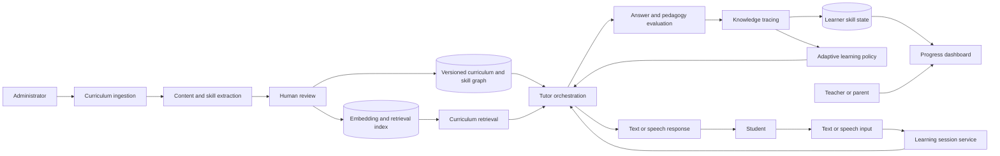

# EducAgent system architecture

> **Status:** Working draft reconstructed from the team's EducAgent architecture and literature-review discussions. It must be reviewed by all five team members before being treated as final.

## Scope

EducAgent is intended to tutor Egyptian primary-school students in mathematics, initially Grades 2–3. The current design separates curriculum preparation from live tutoring so that student sessions use approved, indexed content rather than ingesting arbitrary curriculum material on demand.

## User roles

| Role | Primary responsibilities |
|---|---|
| Student | Starts a learning session, speaks or types answers, receives scaffolded instruction, completes practice, and reviews progress appropriate to the learner. |
| Teacher or parent | Reviews skill mastery, misconceptions, session duration, progress, and areas needing human support. |
| Administrator | Manages users and approved curriculum versions, uploads curriculum material, and monitors ingestion status. |

Access must follow least privilege. A parent or teacher should only see students they are authorised to support, while administrative access to curriculum management should not imply unrestricted access to student data.

## Two-stage system

### Stage A: curriculum preparation

1. An administrator uploads an approved curriculum document and records grade, subject, term, language, source, and version.
2. The backend validates the file and creates a versioned ingestion job.
3. The AI pipeline extracts and segments text while retaining page and section references.
4. A skill-extraction component proposes concepts, skills, prerequisites, and lesson relationships.
5. Human review approves or corrects the extracted curriculum representation.
6. Approved content is embedded and stored in a retrieval index.
7. Structured curriculum, skills, provenance, and embedding references are published as an immutable curriculum version.

Human review is required before newly extracted skills or relationships can affect student learning paths.

### Stage B: live student learning

1. A student starts a session for an approved grade, subject, and learning goal.
2. Speech-to-text converts spoken input when voice mode is enabled; text input follows the same validated message contract.
3. The session service loads authorised learner context and the active curriculum version.
4. Retrieval selects relevant, cited curriculum passages and skill relationships.
5. The tutor or orchestration layer generates a pedagogical action: probe, hint, explanation, prompt, practice item, or summary.
6. An evaluation component checks the student's answer and the proposed tutor response.
7. The knowledge-tracing component updates the estimated state of the affected skills.
8. A learning-policy component chooses whether to continue, increase difficulty, remediate, revisit a prerequisite, or reassess.
9. The response is delivered as text and optionally text-to-speech.
10. The system stores the minimum event data required for progress and evaluation; dashboards receive derived summaries rather than unrestricted transcripts by default.

## Context and learning loop

## Component ownership

| Repository area | Responsibility |
|---|---|
| `apps/` | Student, teacher/parent, and admin experiences |
| `backend/api/` | Authenticated endpoints and transport contracts |
| `backend/core/` | Configuration, security, observability, and shared runtime setup |
| `backend/models/` | Curriculum, learner, session, skill-state, and audit persistence |
| `backend/schemas/` | Validated request, response, event, and AI boundary schemas |
| `backend/services/` | Curriculum management, sessions, progress reporting, and orchestration use cases |
| `ai/` | Extraction, retrieval, tutoring agents, evaluation, knowledge tracing, and adaptation |

## Important boundaries

- The LLM must not be the system of record for identity, permissions, curriculum approval, or learner state.
- Retrieved passages must retain curriculum provenance so claims can be traced to a grade, document, page, and version.
- Model output must be validated before it changes a learner's recorded skill state.
- Speech providers should receive only the audio or text needed for the current operation.
- Raw student transcripts, audio, and detailed telemetry require explicit retention rules.
- Teacher/parent dashboards should distinguish measured evidence, inferred mastery, and model uncertainty.

## Research-to-module map

| Module | Primary supporting research direction |
|---|---|
| Knowledge tracing | KT surveys, Deep Knowledge Tracing, and interpretable baselines |
| Curriculum representation | Core-concept extraction with LLM-guided knowledge graphs |
| Tutor orchestration | Chained LLM tutoring and goal-oriented multi-agent tutoring |
| Tutor behaviour | Scaffolded hints, probing, and delayed answer revelation |
| Evaluation | Learner-outcome metrics plus tutor-quality, safety, cost, and latency evaluation |

See [the research index](../research/README.md) and the six-paper synthesis for the detailed evidence and limitations.

## Open decisions

1. Confirm the exact MVP learning journey and whether voice is required for the first release.
2. Choose the frontend, backend, database, vector store, and deployment target.
3. Decide whether the first KT implementation uses an interpretable baseline, DKT, or another model based on available Egyptian-curriculum interaction data.
4. Define the approved curriculum format and the human-review workflow.
5. Define authentication and the teacher/parent-to-student authorisation model.
6. Define data retention, consent, deletion, and research-study approval.
7. Choose tutoring, embedding, speech, and evaluation models using documented Arabic/Egyptian-dialect tests.
8. Define fallbacks for unavailable models, unsafe output, weak retrieval, and uncertain learner-state estimates.
